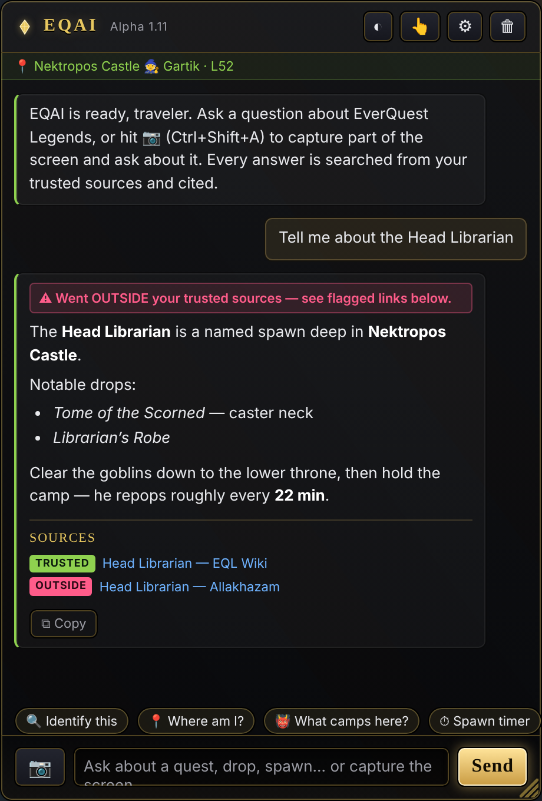
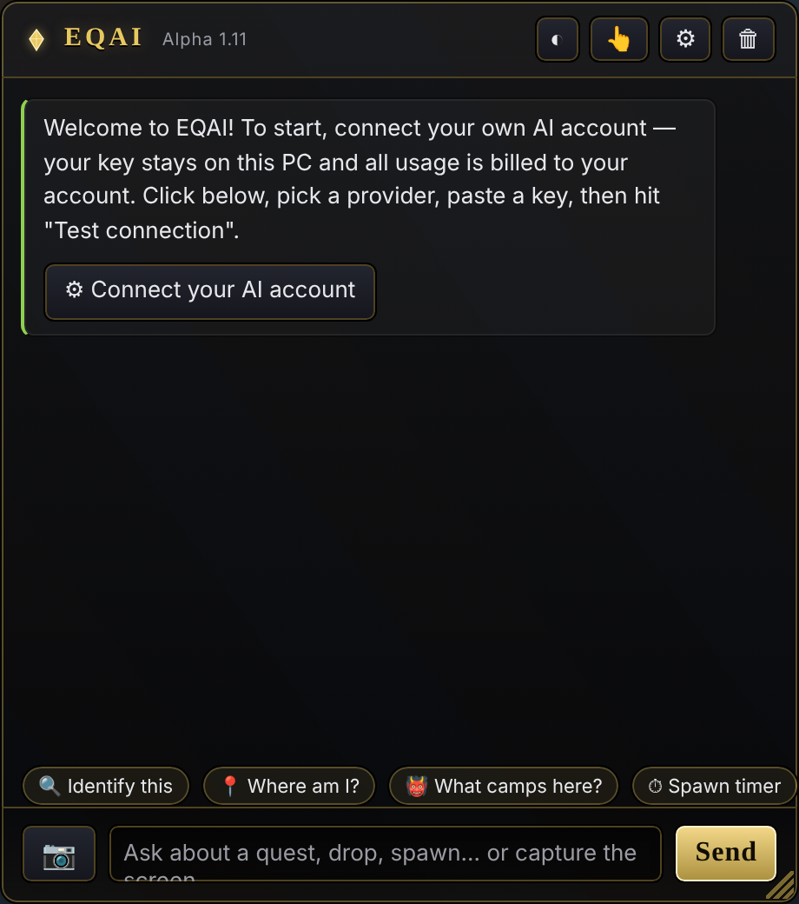
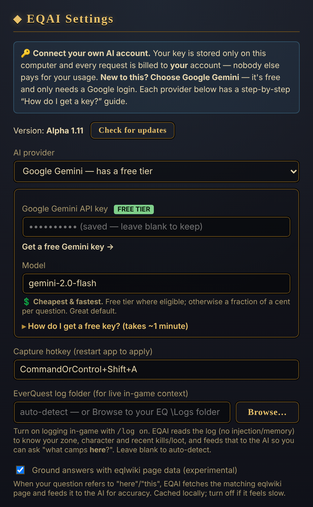

# EQAI — EverQuest Legends AI Overlay

A resizable, always-on-top Windows overlay for **EverQuest Legends** that lets you
ask an AI about the game — either by **capturing part of the screen** (an item
tooltip, a quest window, a mob) or by **typing a question**. Answers are
web-searched and cited, with a clear flag whenever a source falls outside your
trusted list.

> EverQuest Legends is the Daybreak / Game Jawn reimagining of classic EverQuest
> (launched July 28, 2026). EQAI is built specifically for it.

## ⬇ Download (Windows)

### **[Get the latest release →](https://github.com/cadetmedia/EQAI/releases/latest)**

- **`EQAI-portable-*.exe`** — just double-click, no install. Easiest to share.
- **`EQAI-Setup-*.exe`** — installer with Start-menu / desktop shortcuts and
  **silent auto-updates**.

On first launch Windows SmartScreen will warn (the app is unsigned) → click
**More info → Run anyway**. Then open **⚙ Settings** and connect your own AI account.

## What it does

- 📷 **Screen-capture questions** — `Ctrl+Shift+A`, drag a box over anything in game, ask about it.
- 💬 **Typed questions** — quests, drops, spawns, strategy.
- 🔎 **Web-searched + cited** — every answer is grounded in real pages and tagged
  **trusted** / **outside** against your source list (official site, `eqlwiki.com`,
  `r/EQLegends`, …), so you always know where it came from.
- 🔑 **Bring your own AI account** — **Google Gemini (free tier)**, Claude, or
  OpenAI, with a guided setup. Your key stays on your PC; you pay only for your use.
- 🧭 **Live log context** — reads your EQ log (`/log on`) to know your zone, character
  and recent kills/loot, so you can just ask "what camps **here**?" (no injection, no
  memory reads — log file only).
- ⚡ **Local answer cache** — repeat questions are instant and free; eqlwiki page data
  can ground answers for accuracy.
- ⬆ **Auto-updates** — checks on every launch; the installer updates silently.
- 🎮 EverQuest-styled, resizable, always-on-top; runs over borderless-windowed EQ.

## Screenshots

| In-game overlay | First run | Settings |
|---|---|---|
|  |  |  |

*The overlay floats over the game; the green strip shows live context read from your EQ log, and every answer is tagged **trusted**/**outside** with its sources.*

---

## For developers

### Run from source

```bash
git clone https://github.com/cadetmedia/EQAI.git
cd EQAI
npm install
npm start
```

Then **⚙ Settings** → pick a provider → paste a key → Save.

## Build a Windows installer (.exe)

```bash
npm run dist
```

The installer is written to `dist/`.

## Using it with EverQuest

- **Set EQ to Windowed or Borderless Windowed mode.** Overlays cannot draw over
  *exclusive* fullscreen — this is the same constraint every overlay app has.
- Drag the title bar to move the panel; drag any edge/corner to resize.
- The 👆 button toggles **click-through** so mouse clicks pass through the panel
  to the game. Click it again (or `Alt+Tab` back to the overlay) to interact with
  the panel again.

## How answers are sourced (EverQuest Legends)

EQAI is built specifically for **EverQuest Legends** (the Daybreak / Game Jawn
reimagining of classic EverQuest, launched July 28, 2026) — not the 1999 original,
EQ2, or progression servers.

- **Every question triggers a real web search.** Answers are grounded in actual
  pages, not the model's memory — important for a game this new.
- **Trusted sources are set in Settings** (one per line — a domain, or a
  domain with a path to trust only that section, e.g. `reddit.com/r/EQLegends`).
  Defaults: `everquestlegends.com`, `eqlwiki.com`, `daybreakgames.com`,
  `eqprogression.com`, `reddit.com/r/EQLegends`.
- **The app classifies every cited source itself.** Each answer shows a banner:
  - ✓ *Answered from your trusted sources* — all citations are on your list.
  - ⚠ *Went outside your trusted sources* — at least one citation is not, and each
    source is tagged **trusted** or **outside** with a clickable link.
  - ⚠ *No sources cited* — the model didn't ground the answer; treat with caution.

  This tagging is done by EQAI from the cited domains, so the disclosure is
  guaranteed by the app rather than relying on the model to admit it.

> **Providers & cost:** pick one in Settings and connect your own account — the key
> stays on your machine and usage bills to you.
> - **Google Gemini** — has a **free tier** (key from Google AI Studio, just a Google
>   login, no credit card). Easiest/cheapest; grounded with Google Search.
> - **Claude (Anthropic)** / **OpenAI** — pay-as-you-go API keys; web search may carry
>   separate per-search pricing and must be enabled on the account.
>
> Each provider has an in-app step-by-step "How do I get a key?" walkthrough, plus a
> "Test connection" button to confirm it's linked.

## Notes & design

- **Safe by design:** this only reads *pixels* (screenshots). It never reads game
  memory or injects into the client, which keeps it in the low-risk category of
  overlay. Keep it that way.
- **API keys** are stored locally in Electron's `userData/settings.json`. They
  are only ever sent to the provider you selected, from the main process.
- **Model names are configurable** in Settings. The defaults are placeholders —
  set them to whatever model your account currently has access to.
- **Primary display only** for region capture in this version (multi-monitor
  capture of the display the overlay sits on works; picking a *different* monitor
  is a future enhancement).

## Versioning & updates

EQAI shows its version in the title bar and in Settings, and checks for a newer
release **every time it launches** (plus a manual **Check for updates** button in
Settings).

**Release naming** (semver under the hood → friendly label shown to users):

| package.json `version` | Shown as   |
|------------------------|------------|
| `1.0.0-alpha.0`        | Alpha 1.0  |
| `1.0.0-alpha.1`        | Alpha 1.1  |
| `1.0.0-beta.0`         | Beta 1.0   |
| `1.0.0`                | 1.0        |
| `1.1.0`                | 1.1        |

To cut a release: bump `version` in `package.json`, run `npm run dist`, publish the
new `.exe`, and update your `latest.json` (see `latest.json.example`) so existing
installs detect it. The update check compares versions with full semver precedence
(alpha < beta < final), so a user on Alpha 1.0 is correctly offered Beta 1.0 or 1.0.

**Cutting a release (automated):** this repo has a GitHub Actions workflow
(`.github/workflows/release.yml`) that builds the Windows packages on a real
Windows runner and publishes a GitHub Release. To release:

1. Bump `version` in `package.json` (e.g. `1.0.0-alpha.1`).
2. Commit and push to `main`:
   ```bash
   git commit -am "Alpha 1.1"
   git push origin main
   ```
3. The workflow builds `EQAI Setup …exe` + `EQAI-portable-…exe`, generates
   `latest.json`, creates the `v1.0.0-alpha.1` tag, and attaches all three to a new
   GitHub Release. (Pushes that don't change the version are ignored — the release
   for that version already exists.)

Installed copies then see the update on next launch (the feed URL below resolves to
the newest release's `latest.json`). Releases are **not** marked as GitHub
"prerelease" even for alpha/beta, so the stable `releases/latest` URL keeps working.

**Silent updates (installer):** the installer is a per-user **one-click** build, so
the app updates itself the clean way — it downloads the new version in the
background and, when you click **Restart & install**, swaps itself and relaunches
with **no setup wizard, no UAC prompt, and no need to tab out of the game**. (The
portable `.exe` can't self-replace, so it shows a Download link instead.)

**Update feed:** `updateFeedUrl` in Settings points at a small JSON file you host
(e.g. a GitHub raw `latest.json`). When its `version` is newer than the installed
one, EQAI shows an "Update available" banner with a **Download** button that opens
the `url`. (This opens the download page in the browser — it does not silently
install, which also means it works for the portable build.)

## Possible next steps

- Reading the EQ log file for auto-context (zone, cons, item links, spawn timers)
- A local cache/knowledge base of past answers to cut API cost and speed repeats
- A character profile (class/level/race) auto-added to the prompt
- Multi-monitor region picking and one-key re-capture of the last region
- A live model dropdown pulled from each provider's models endpoint
- Code signing to remove the first-download SmartScreen warning
